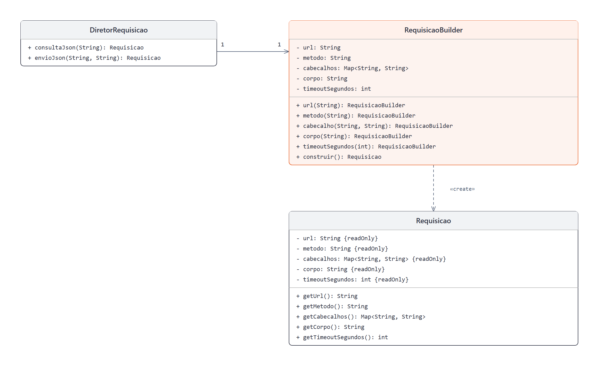

# DCC078 - Padrões de Projeto: Builder

**Aluno:** Felipe Lazzarini Cunha

## Tema

O projeto representa a montagem de requisições HTTP, que combinam um campo obrigatório (a URL) com vários opcionais, como método, cabeçalhos, corpo e tempo limite. O Builder constrói o objeto passo a passo, valida o resultado e entrega uma `Requisicao` imutável; um diretor encapsula configurações recorrentes. Nenhuma requisição é realmente enviada.

## Diagrama de Classes UML



## Estrutura do Projeto

- `Requisicao`: produto imutável, criado apenas pelo builder.
- `RequisicaoBuilder`: constrói a requisição por chamadas encadeadas e valida as regras em `construir()`.
- `DiretorRequisicao`: diretor que monta consultas e envios JSON usando o builder.

## Testes

Com JDK 11 ou superior e Maven:

```bash
mvn test
```
